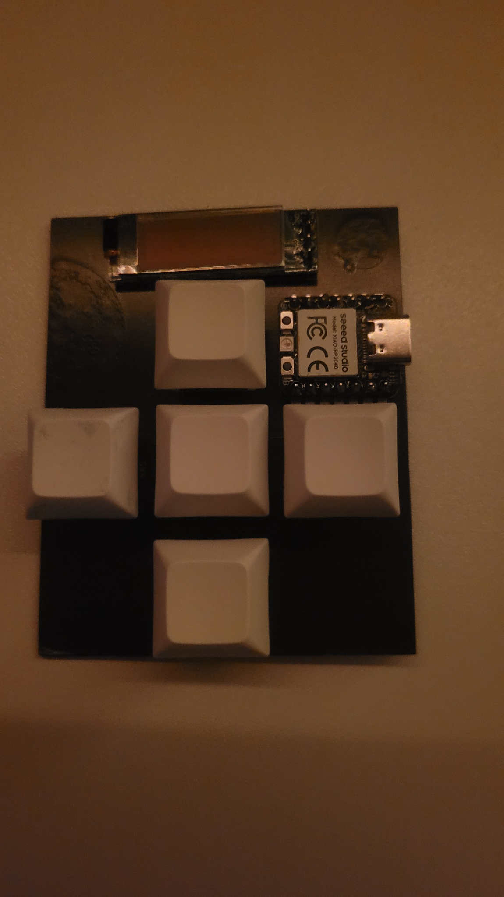
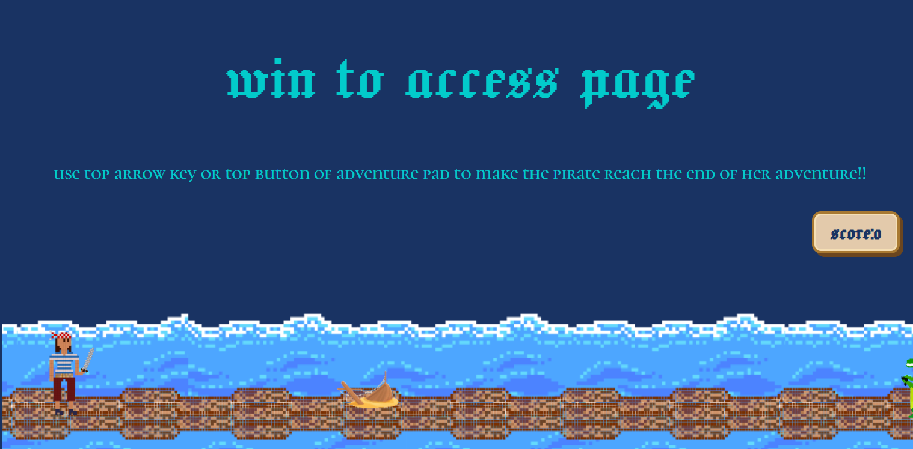
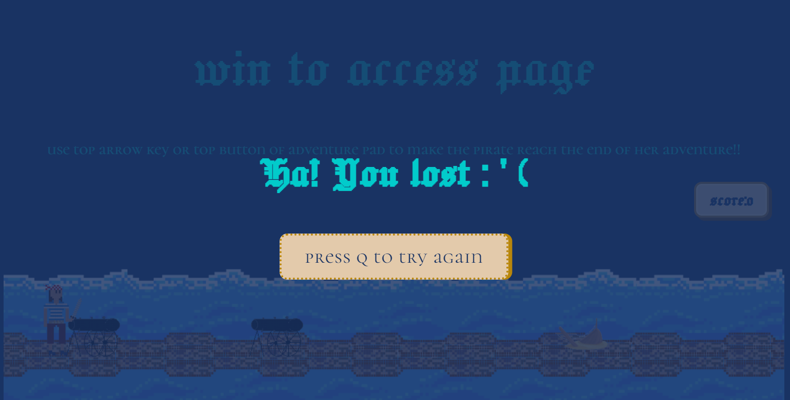
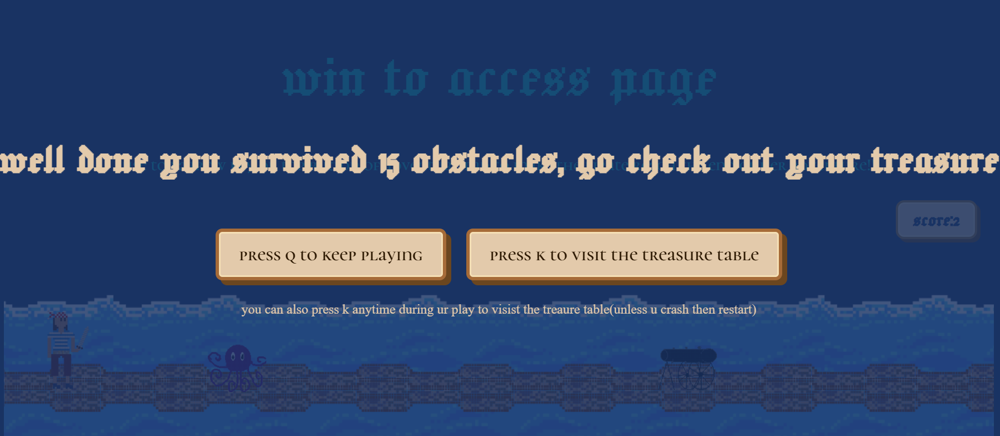
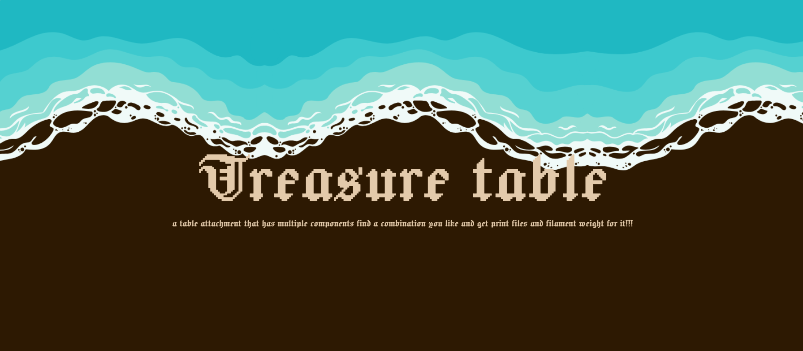
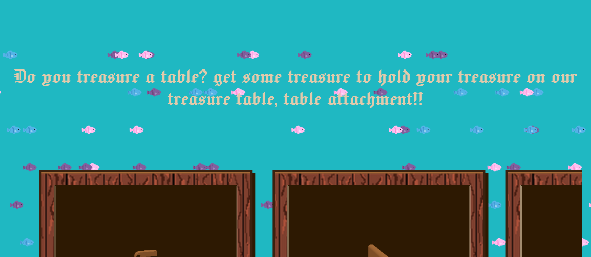
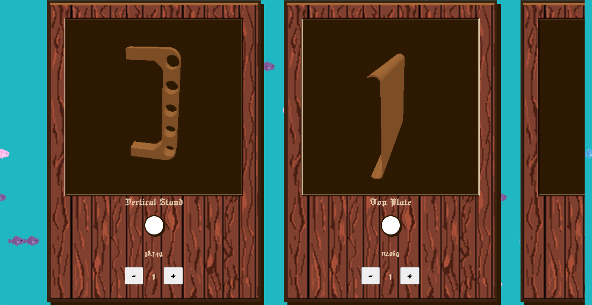
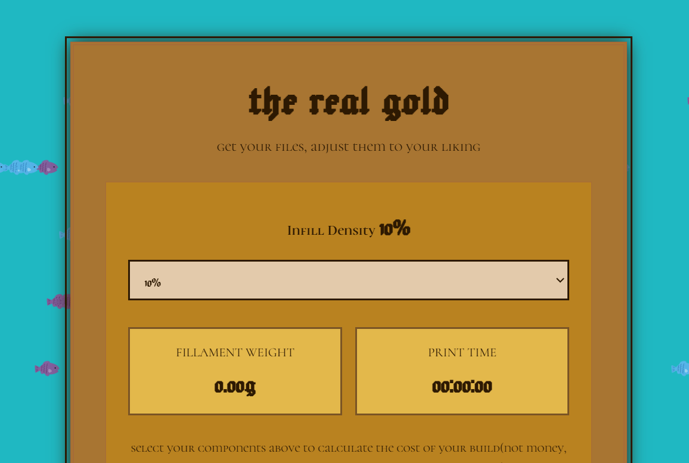
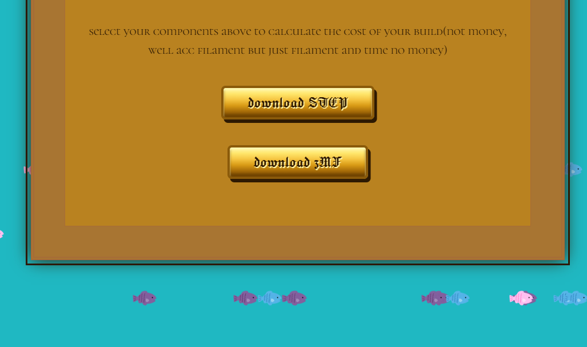

# Dowel Based shelf for desk

Its a dowel based shelf with 3D printed supports for dowels, modular attachments screw onto or snap onto the dowels.

Website will allow the user to pick and place components and will give a zip file which will include all the files required as well as a BOM for non 3D printed parts.

okay website and macropad turn.
so i made a mouse macropad as my very first hardware project and my very first hackclub project, but alas i soldered it horribly once and made a case too little , luckily i still had 4 more circut boards and oliver whos great at firmware. so we upcycles the firmware to make it the only keys needed to use the site , you might need a mouse on page 2 but yeah thats all good. 

so the firmware is on olivers githhub and the macropad looks like, well this 
 
( would flash firmware but i lost my data cable so it doesnt work :(  )
anyways onto the site 

 how it opens press up arrow to jump. and if youre feeling a bit lazy just press k . or if u jave a macropad , press the top button to jump and the right button to skip to next page
when u loose/crash into an obstacle

after you  jump over 15 obstacles

 q is the leftmost button on the macropad

after you press k^

 
you can move the models around, also on certain browsers the first 2 will not be visible due to rendering limits
, hover over the cicle and press m to select . m is the middle most button , you can also press q and k to scroll horizontally and up and down to scroll well up and down .

rough layout btw 
       up     

q      m      k

      down
 yes it spells qmk and also q just holds a special place in my heart bc yeah 

 finslly 
  once you select something it shows thr weight and time here , infils affect too

 
 finally you can download a zip file in either 3mf or step !!
 thats all i hope you enjoy!!